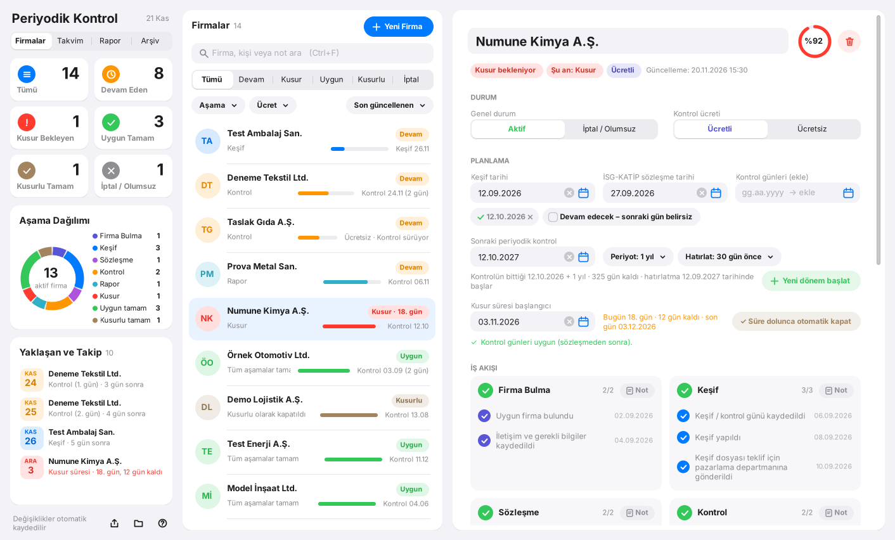
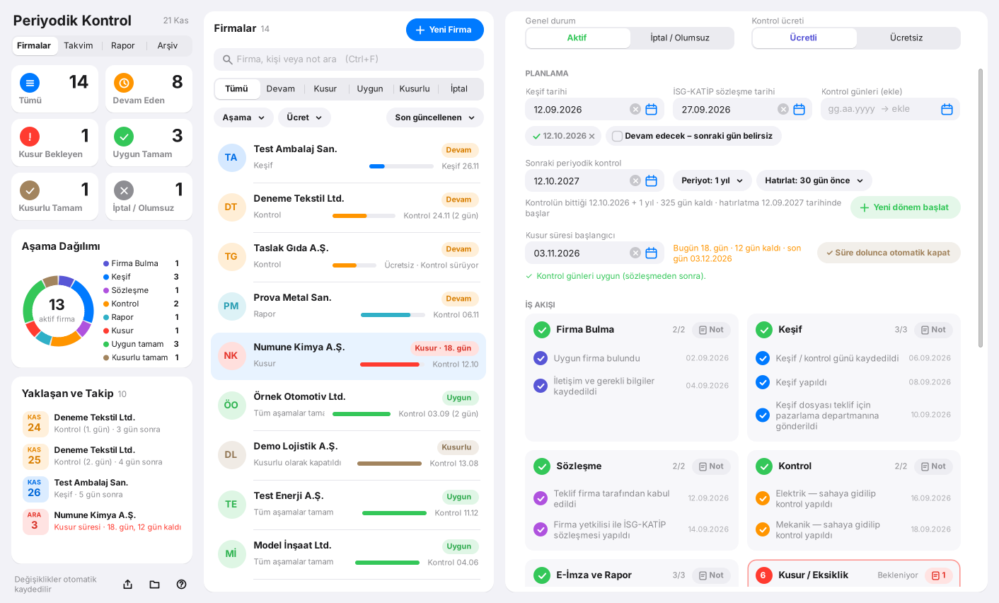
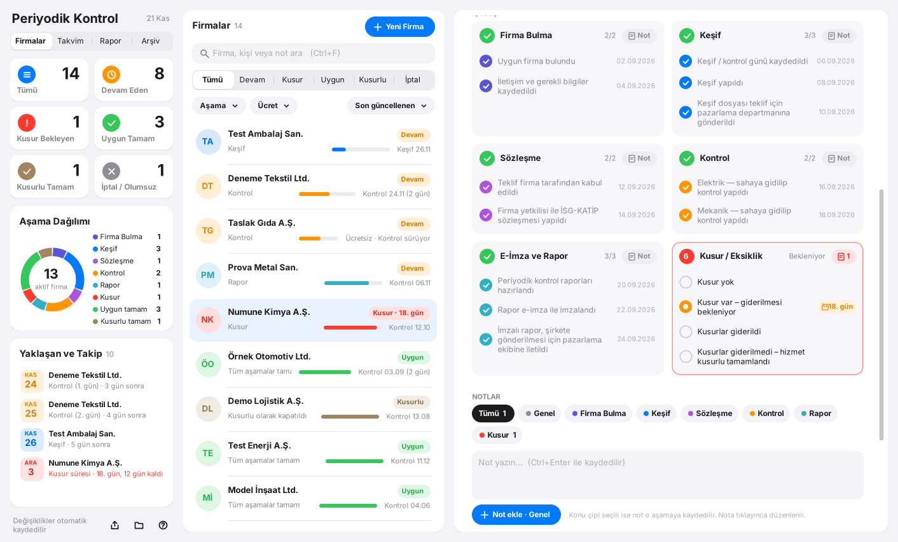
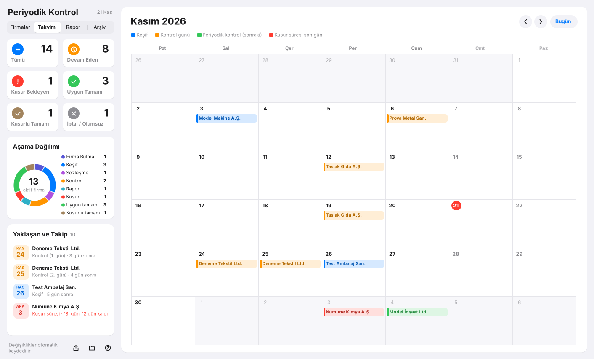
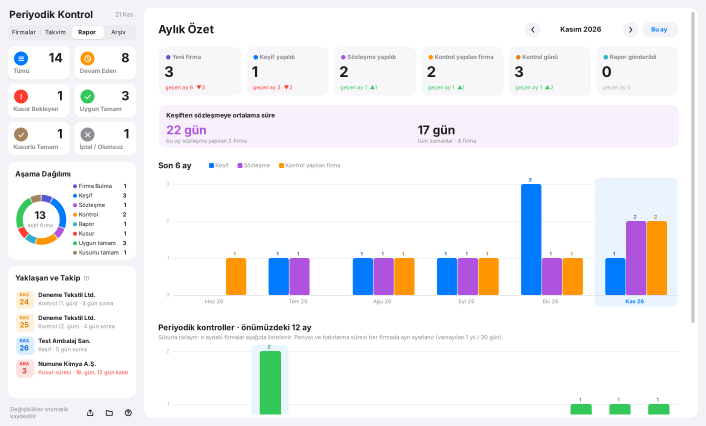
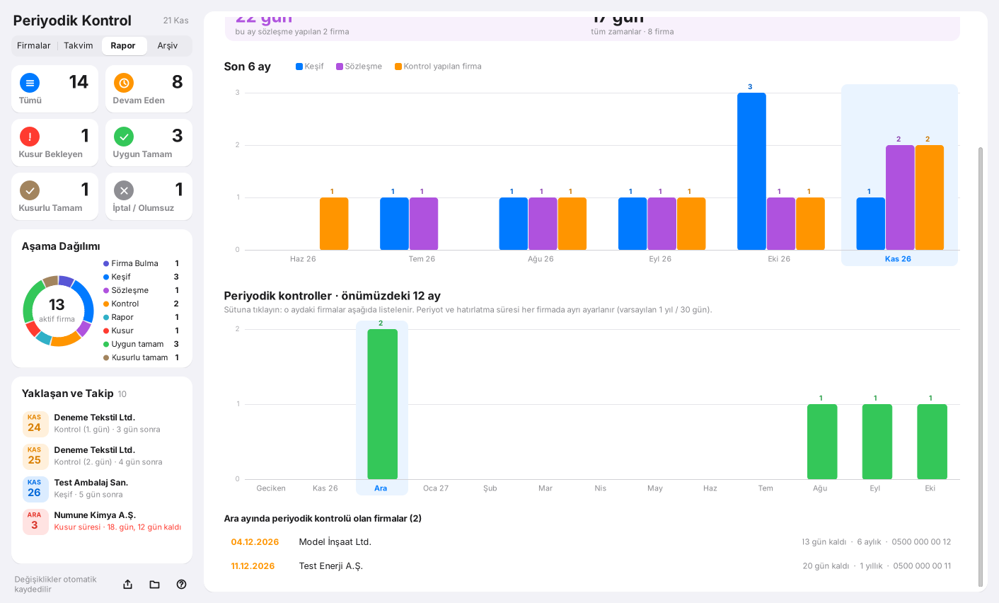
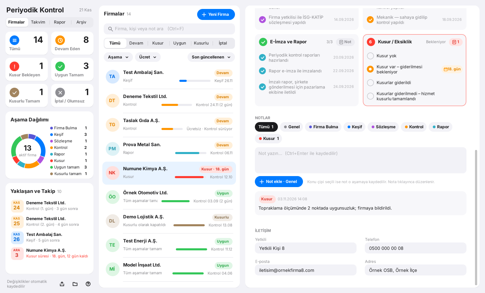

# Periyodik Kontrol Takip

Elektrik ve mekanik **periyodik kontrol** hizmetlerinin satış öncesinden rapor teslimine ve yıllık yenilemeye kadar tüm sürecini tek ekranda takip eden, sade bir Windows masaüstü uygulaması.

Elektrik-elektronik mühendisi olarak periyodik kontrol uzmanlığı yaptığım dönemde, firma takibini düzenli hâle getirmek için kendi ihtiyacımdan yola çıkarak geliştirdim. Günlük işte kullandım ve sahada ihtiyaç duyulan özellikleri zamanla ekledim.

> Bu depodaki tüm firma bilgileri **örnek veridir** (Örnek Plastik A.Ş., Demo Mobilya Ltd. …). Gerçek müşteri bilgisi içermez.



## Neden?

Periyodik kontrol işinde tek bir firma için haftalar süren çok adımlı bir süreç var: firma bulma, keşif, teklif, İSG-KATİP sözleşmesi, saha kontrolü (çoğu zaman birkaç güne yayılır), rapor ve e-imza, kusurların giderilmesinin takibi ve bir yıl sonra kontrolün yenilenmesi. Onlarca firma aynı anda farklı aşamalarda olunca şu sorular kayboluyordu:

- Hangi firma hangi aşamada, kim neyi bekliyor?
- Teklifi gönderilip unutulan firma var mı?
- Kusur bildirilen firmanın 30 günlük süresi ne zaman doluyor?
- Gelecek ay hangi firmaların yıllık kontrolü var?

Uygulama bu soruları açılış ekranında yanıtlıyor.

## Özellikler

**İş akışı (6 aşama)**
1. Firma Bulma: uygun firma bulundu, iletişim bilgileri kaydedildi
2. Keşif: keşif günü kaydedildi, keşif yapıldı, keşif dosyası teklif için pazarlamaya gönderildi
3. Sözleşme: teklif kabul edildi, İSG-KATİP sözleşmesi yapıldı
4. Kontrol: elektrik ve mekanik ayrı ayrı (gerekmeyen kalem "Gerekmiyor" olarak işaretlenebilir)
5. E-İmza ve Rapor: rapor hazırlandı, e-imza ile imzalandı, pazarlamaya iletildi
6. Kusur / Eksiklik: kusur yok / kusur var, giderilmesi bekleniyor / giderildi / giderilmedi, hizmet kusurlu tamamlandı

**Takip ve hatırlatmalar**
- **Durum sayıları:** Devam eden, kusur bekleyen, uygun tamamlanan, kusurlu tamamlanan ve iptal edilen firmalar ayrı ayrı sayılır; kutucuğa tıklayınca liste o duruma süzülür.
- **Aşama dağılımı:** Halka grafik; bir aşamaya tıklayınca o aşamadaki firmalar listelenir.
- **Yaklaşan ve Takip:** Yaklaşan keşif ve kontrol günleri, kusur süresi, yıllık kontrol hatırlatmaları ve hareketsiz firmalar tek listede.
- **Kusur süresi:** Varsayılan 30 gün sayılır. Süre dolup kusurlar giderilmezse firma otomatik olarak "kusurlu tamamlandı" durumuna geçer, firmaya not eklenir ve kullanıcıya bildirilir. Bu davranış firma bazında kapatılabilir.
- **Çok günlü kontrol:** Birden fazla kontrol günü eklenebilir. Geçmiş günler "gecikti" sayılmaz; sonraki gün belli değilse "devam edecek" olarak işaretlenir.
- **Periyodik yenileme:** Kontrol bitince sonraki kontrol tarihi kendiliğinden hesaplanır. Periyot (varsayılan 1 yıl) ve kaç gün önce hatırlatılacağı (varsayılan 30 gün) her firmada ayrı ayarlanır. "Yeni dönem başlat" bu dönemi kapatıp iş akışını sıfırlar.
- **Hareketsiz firma uyarısı:** 14 gündür üzerinde işlem yapılmayan devam eden firmalar "Beklemede" olarak işaretlenir; böylece unutulan teklifler yakalanır.

**Ekranlar**
- **Takvim:** Keşif, kontrol günleri, periyodik kontrol ve kusur süresi son günleri aylık görünümde.
- **Rapor:** Aylık özet (geçen ayla karşılaştırmalı), keşiften sözleşmeye ortalama süre, son 6 ay grafiği ve önümüzdeki 12 ayın periyodik kontrol grafiği.
- **Arşiv:** Silinen firma kalıcı olarak gitmez, arşive düşer; buradan geri alınabilir.

**Diğer**
- Aşamaya göre konu seçilerek tutulan notlar
- Her işaretin tarihi tutulur ve sonradan düzeltilebilir
- Arama (firma, kişi, not içi), filtreler, sıralama ve klavye kısayolları
- Biçimli **Excel (.xlsx)** dışa aktarma (4 sayfa: Firmalar, Notlar, Periyodik Kontrol, Aylık Özet); harici kütüphane kullanılmadan yazılır
- Otomatik kayıt, günlük otomatik yedek (son 30 gün), eski veri sürümlerinden otomatik geçiş

## Ekran görüntüleri

| | |
|---|---|
|  |  |
| Planlama: kontrol günleri, periyot ve hatırlatma, kusur süresi | İş akışı kartları ve işaret tarihleri |
|  |  |
| Aylık takvim | Aylık özet ve son 6 ay |
|  |  |
| Önümüzdeki 12 ayın periyodik kontrolleri | Konuya göre notlar |

## Kurulum

1. [`dist/PeriyodikKontrolTakip.zip`](dist/PeriyodikKontrolTakip.zip) dosyasını indirip bir klasöre açın (Masaüstü veya `D:\`; *Program Files* içine koymayın).
2. `PeriyodikKontrolTakip.exe` dosyasını çalıştırın.
   - "Windows bilgisayarınızı korudu" uyarısı çıkarsa **Ek bilgi → Yine de çalıştır** deyin. Uygulama dijital imzalı olmadığı için bu uyarı normaldir.
3. Örnek veriyle denemek için zip içindeki `ornek-veri` klasörünün adını `veri` yapın.

**Gereksinim:** Windows 10 veya 11. Gereken .NET Framework 4.x Windows ile birlikte gelir; ek bir kurulum gerekmez. Uygulama internet bağlantısı kullanmaz.

Ayrıntılı kullanım için [KULLANIM.txt](KULLANIM.txt) dosyasına bakın.

## Derleme

| Ortam | Komut |
|---|---|
| Windows (ek kurulum gerekmez) | `build.bat` |
| Linux / macOS (Mono) | `./build.sh` |

Çıktı: `dist/PeriyodikKontrolTakip.exe`

## Teknik notlar

- **Dil ve çatı:** C#, WinForms, .NET Framework 4.5+ (C# 5 ile uyumlu). Tek bir exe; NuGet bağımlılığı yok.
- **Arayüz:** iOS esinli, sade bir tasarım. Kartlar, segment kontrolleri, çipler, halka ve sütun grafikleri GDI+ ile özel olarak çiziliyor. Yüksek DPI ekranlarda ölçekleniyor.
- **Veri:** exe'nin yanındaki `veri/firmalar.json` dosyasında tutulur. Kayıt sırasında önce geçici dosyaya yazılıp sonra değiştirildiği için veri bozulmaya karşı korunur. Günlük yedekler `veri/yedekler/` klasörüne alınır.
- **Excel:** .xlsx dosyası, SpreadsheetML formatı `System.IO.Compression` ile elle yazılarak oluşturulur.

```
src/
  Core.cs       veri modeli, iş akışı kuralları, kayıt/yükleme, sürüm geçişi, aylık istatistik
  Controls.cs   özel çizilmiş arayüz bileşenleri (liste, aşama kartı, tarih alanı, grafikler…)
  Views.cs      takvim ve rapor ekranları
  Xlsx.cs       bağımlılıksız .xlsx yazıcı
  MainForm.cs   ana pencere, yerleşim, kısayollar
  Program.cs    giriş noktası, tek pencere kilidi, hata kaydı
ornek-veri/     örnek firmalar (gerçek veri değildir)
docs/ekran/     ekran görüntüleri (örnek veriyle)
```

## Yazar

**Bilal Altundağ**, Elektrik-Elektronik Mühendisi
[GitHub](https://github.com/BilalAltundag) · [Web sitesi](https://bilal-altundag-website.vercel.app)

## Lisans

[MIT](LICENSE)
